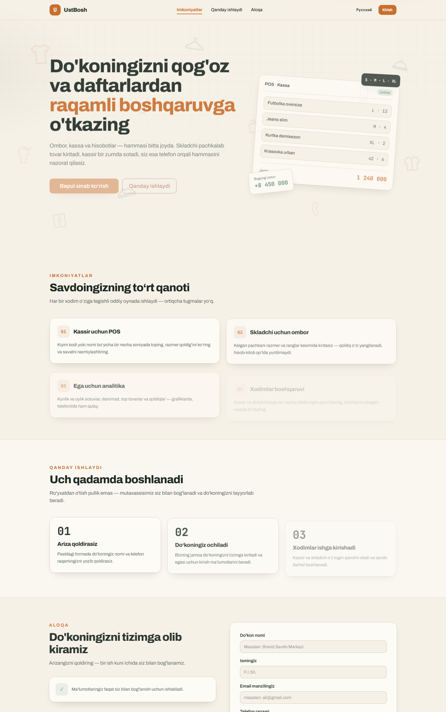
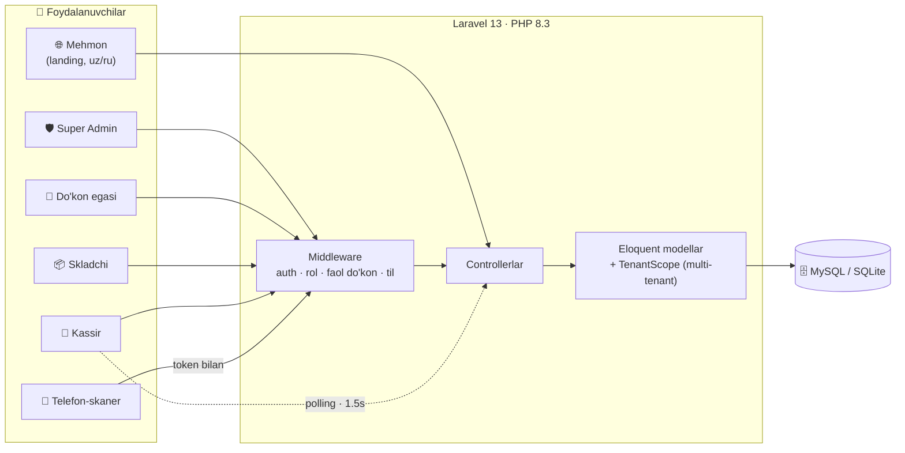

<div align="center">

# 🧾 UstBosh

### Kiyim-kechak do'konlari uchun savdo, ombor va hisobot tizimi

**Ombor · Kassa · Xodimlar · Hisobotlar · Telefon-skaner — hammasi bitta tizimda**

[](https://ust-bosh.page.gd/)
[](#-testlar)
[](LICENSE)


</div>

---

## 📖 Loyiha haqida

**UstBosh** — kiyim-kechak do'konlarini qog'oz daftarlardan raqamli boshqaruvga o'tkazadigan
to'liq veb-tizim. Bitta platformada to'rt rol ishlaydi: **tizim administratori**, **do'kon egasi**,
**skladchi** va **kassir**. Har bir xodim faqat o'ziga tegishli oynani ko'radi — ortiqcha tugma
va murakkablik yo'q.

- 🏪 Har bir do'kon ma'lumotlari bir-biridan to'liq izolyatsiya qilingan (multi-tenant)
- 📱 Telefon kamerasi bilan shtrix-kod skanerlash — **Pusher, WebSocket, cron va queue talab qilinmaydi**, shuning uchun byudjetli hostingda ham ishlaydi
- 🇺🇿🇷🇺 Interfeys o'zbek va rus tillarida
- 🧪 235 ta avtomatik test bilan qoplangan

### 🌐 Jonli demo: [ust-bosh.page.gd](https://ust-bosh.page.gd/)

<div align="center">
  
</div>

---

## ✨ Imkoniyatlar

### 🌐 Landing sahifasi va arizalar
- Ikki tilli (o'zbek/rus) landing, tilni istalgan payt almashtirish
- Do'kon ochish uchun ariza formasi (AJAX), telefon va email formatini tekshirish
- Dublikat arizalarga qarshi himoya: email/telefon bo'yicha takroriy arizalar ushlanadi
- Spamga qarshi rate limit: daqiqada 3 ta, soatda 10 ta ariza

### 🛡️ Super Admin
- Do'kon ochish arizalarini ko'rib chiqish: **tasdiqlash** (do'kon va egasi akkaunti yaratiladi,
  parol o'rnatish havolasi emailga yuboriladi), **rad etish** (sabab bilan, mijoz tilida email) va
  emailni qayta yuborish
- Do'konlarni boshqarish: faollashtirish / to'xtatib turish, ma'lumotlarni tahrirlash
- Xodimlarni faolsizlantirish va parolini tiklash
- Mahsulotlarni tahrirlash, ombor qoldig'ini to'g'rilash, sotuvni bekor qilish
- **Audit jurnali** — administratorning barcha muhim amallari yozib boriladi

### 👔 Do'kon egasi
- Dashboard: bugungi savdo, tushum, o'rtacha chek, eng ko'p sotilgan tovarlar
- Hisobotlar: kunlik statistika, top mahsulotlar, naqd/karta taqsimoti, kam qoldiqdagi tovarlar
- Hisobotni **Excel (XLSX)** formatida yuklab olish va chop etish
- Xodimlar boshqaruvi: qo'shish, tahrirlash, faolsizlantirish va parolni yangilash
  (parol yangilanganda xodimning barcha sessiyalari bekor qilinadi)
- Sotuvlar tarixi: chekni ko'rish, kerak bo'lsa bekor qilish
- Ombor qoldiqlari va harakatlar tarixi, xodimlar faolligi (login jurnali)

### 📦 Skladchi
- Mahsulot kartalari: nom, SKU, narx, razmer (S–XXL) va rang variantlari, barcode
- Qoldiq har bir variant kesimida real vaqtda yuritiladi
- Pachkalab kirim qabul qilish — **idempotent**: forma ikki marta yuborilsa ham dublikat kirim yaratilmaydi
- Kirimni bekor qilish va qoldiqni avtomatik qaytarish
- Shtrix-kodlarni chop etish, mahsulotlar va variantlar bo'yicha tezkor qidiruv
- Kam qoldiq va tugab qolgan tovarlar nazorati

### 🧾 Kassir — POS
- Bir necha soniyada ishlaydigan qidiruv: nom, SKU yoki barcode bo'yicha, razmer/qoldiq kesimida
- Savat: mobil va desktop uchun moslashgan, klaviatura bilan tez ishlash
- Naqd va karta to'lovlari, olingan pul va qaytim
- Chekni chop etish
- **Idempotent sotuv** — tugma ikki marta bosilsa yoki tarmoq uzilsa ham sotuv takrorlanmaydi
- Sotuvlar tarixi va bekor qilish imkoniyati

### 📱 Telefon-skaner
POS bilan bir xil tarmoqdagi telefon shtrix-kod skaneri vazifasini bajaradi:

1. Kassir POS'da **«📱 Qurilmani ulash»** tugmasini bosadi — QR kod chiqadi
2. Telefon kamerasi bilan QR kod skanerlanadi
3. Telefonda skaner sahifasi ochiladi va kamera orqali tovar shtrix-kodlari o'qiladi
4. Skanerlangan tovar **~1.5 soniya ichida** POS savatiga tushadi
5. Xavfsizlik: token 15 daqiqada eskiradi, faqat shu kassir sessiyasiga va shu do'konga cheklangan,
   bazada faqat token hash'i saqlanadi

Skaner **polling** asosida ishlaydi — WebSocket/Pusher infratuzilmasi shart emas. Kamera
ruxsati berilmasa ham sahifada qo'lda kiritish va qidiruv rejimi mavjud.

---

## 🧱 Texnologiyalar

| Qatlam | Texnologiya |
|---|---|
| Backend | PHP 8.3+, Laravel 13 |
| Ma'lumotlar bazasi | MySQL (production), SQLite (local va testlar) |
| Frontend | Blade, Tailwind CSS 4 (browser CDN), daisyUI 5, sof JavaScript |
| Excel hisobot | [PhpSpreadsheet](https://phpspreadsheet.readthedocs.io/) |
| Shtrix-kod skaner | [html5-qrcode](https://github.com/mebjas/html5-qrcode) + QR juftlash |
| Hisobotni chop etish | Brauzerning `window.print()` oynasi |
| Testlar | PHPUnit 12 (235 test, 869 assertion) |
| Kod uslubi | [Laravel Pint](https://laravel.com/docs/pint) |

> Loyihada `npm`/`vite` ishlatilmaydi — Tailwind CDN orqali ulanadi, shuning uchun joylashtirish
> (deploy) uchun qo'shimcha build qadami talab qilinmaydi.

---

## 🏗 Arxitektura



Qoldiqqa ta'sir qiladigan har bir amal (kirim, sotuv, bekor qilish, to'g'rilash)
`inventory_movements` jurnalida saqlanadi — harakatlar tarixi to'liq kuzatib boriladi.

---

## 🔐 Xavfsizlik

- **Rolga asoslangan kirish**: `role:owner`, `role:warehouse`, `role:cashier` middleware'lari, faol do'kon
  (`shop.active`) va parol almashtirilganlik talabi (`password.changed`)
- **Multi-tenant izolyatsiya**: `TenantScope` global scope'i orqali har bir do'kon faqat o'z ma'lumotlarini ko'radi
- **Sessiyalarni masofadan bekor qilish**: xodim bloklanganda yoki paroli yangilanganda `auth_version` oshiriladi
- **Idempotentlik**: sotuv va kirimlar `idempotency_key` bilan takroriy yuborishdan himoyalangan
- **Tranzaksiyalar va `lockForUpdate`**: qoldiq parallel sotuvlarda ham to'g'ri hisoblanadi
- **Rate limiting**: login, parol tiklash, ariza yuborish, skaner va boshqa nozik nuqtalarda so'rovlar cheklangan
- **Xavfsizlik sarlavhalari**: CSP, `X-Frame-Options`, `X-Content-Type-Options`, `Referrer-Policy`
- **Maxfiy ma'lumotlar** faqat `.env`da — repoga hech qachon tushmaydi (`.env`, `.env.production` `.gitignore`da)

---

## ⚙️ O'rnatish

### Talablar

- PHP **8.3+** (kengaytmalar: `mbstring`, `zip`, `gd`, `dom`, `xml`, `sqlite3` yoki `pdo_mysql`)
- [Composer 2](https://getcomposer.org/)

### Qadamlar

```bash
# 1. Reponi klonlash
git clone https://github.com/<username>/ust-bosh.git
cd ust-bosh

# 2. Tez o'rnatish: composer install + .env + SQLite + migratsiya
composer run setup

# 3. Demo ma'lumotlar (faqat local uchun)
php artisan db:seed

# 4. Serverni ishga tushirish
composer run dev
# yoki oddiy variant: php artisan serve
```

Sayt `http://localhost:8000` manzilida ochiladi.

### Admin panel

Super Admin `.env`dagi `ADMIN_EMAIL` va `ADMIN_PASSWORD` asosida birinchi login paytida
avtomatik yaratiladi:

```env
ADMIN_EMAIL=admin@example.com
ADMIN_PASSWORD=kuchli-parol-yozing
```

Admin panel manzili: `/admin`

### Demo akkauntlar (faqat `local` muhitda)

| Rol | Login | Parol |
|---|---|---|
| Do'kon egasi | `owner@demo.uz` | `DemoParol123` |

> Skladchi va kassir akkauntlarini do'kon egasi panel orqali yaratadi.

---

## 🧪 Testlar

```bash
php artisan test --compact
```

Joriy holat: **235 test · 869 assertion · barchasi muvaffaqiyatli**

Testlar asosiy oqimlarni va xavfsizlik chegaralarini qamrab oladi:

| Yo'nalish | Nima tekshiriladi |
|---|---|
| `LandingTest` | Landing, arizalar, dublikatlar, til almashtirish |
| `AdminTest`, `AdminShopManagementTest` | Admin autentifikatsiyasi, do'konlarni boshqarish, audit |
| `AuthTest`, `RateLimitTest`, `SecurityHeadersTest`, `TrustedProxyTest` | Login, parol tiklash, rate limit, xavfsizlik sarlavhalari |
| `OwnerDashboardTest`, `OwnerManagementTest`, `OwnerSalesTest`, `OwnerReportExportTest` | Ega paneli, xodimlar, sotuvlar, Excel hisobot |
| `WarehouseTest`, `WarehouseManagementTest` | Mahsulotlar, variantlar, kirimlar, bekor qilish |
| `PosTest`, `PosSalesTest`, `PosScannerTest` | POS qidiruvi, sotuvlar, telefon-skaner oqimi |
| `ErrorPagesTest`, `AjaxTest`, `DatabaseErrorTest` | Xato sahifalari va AJAX javoblari |

---

## 🚀 Serverga joylash (deploy)

Loyiha oddiy umumiy hostingda (shared hosting, masalan [InfinityFree](https://infinityfree.com))
ishlashi uchun mo'ljallangan — WebSocket, queue va cron talab qilinmaydi.

1. Fayllarni serverga yuklang. Ildizdagi `.htaccess` barcha so'rovlarni avtomatik ravishda
   `public/` papkaga yo'naltiradi.
2. `composer install --no-dev --optimize-autoloader` buyrug'ini bajaring.
3. `.env` faylini sozlang:

```env
APP_ENV=production
APP_DEBUG=false
APP_URL=https://sizning-domen.uz

DB_CONNECTION=mysql
DB_HOST=...
DB_DATABASE=...
DB_USERNAME=...
DB_PASSWORD=...

SESSION_SECURE_COOKIE=true
```

4. Migratsiyalarni bajaring va optimizatsiya qiling:

```bash
php artisan migrate --force
php artisan config:cache
php artisan route:cache
php artisan view:cache
```

> ⚠️ Kamera API faqat HTTPS orqali ishlaydi — telefon-skanerdan foydalanish uchun SSL sertifikat shart.

---

## 🗂 Loyiha tuzilishi

```
app/
├── Http/
│   ├── Controllers/        # Admin, Owner, Warehouse, POS, Scanner, Auth, Landing
│   └── Middleware/         # Rol, faol do'kon, til, xavfsizlik sarlavhalari
├── Models/                 # Shop, User, Product, ProductVariant, Sale, StockReceipt...
├── Support/                # Excel hisobot, yordamchi funksiyalar
├── Mail/                   # Ariza tasdiqlash/rad etish xatlari
└── Notifications/          # Parolni tiklash xabarnomasi

database/
├── migrations/             # 27 ta migratsiya
├── factories/              # Test ma'lumotlari
└── seeders/                # Demo va admin seed

resources/views/
├── landing/                # Ommaviy sahifa (uz/ru)
├── auth/                   # Kirish, parol amallari
├── admin/                  # Super Admin paneli
├── owner/                  # Do'kon egasi paneli va hisobotlar
├── warehouse/              # Sklad paneli va shtrix-kod chop etish
├── pos/                    # Kassa (POS) va cheklar
├── scanner/                # Telefon-skaner sahifasi
└── errors/                 # 401, 403, 404, 419, 429, 500, 503 sahifalari

routes/web.php              # Barcha marshrutlar
public/                     # Entry point, CSS/JS, .htaccess
tests/                      # 235 ta test
```

---

## 🤝 Hissa qo'shish

1. Reponi fork qiling
2. Yangi branch oching: `git checkout -b feature/yangi-imkoniyat`
3. O'zgarishlardan so'ng testlarni ishga tushiring: `php artisan test --compact`
4. Kod uslubini tekshiring: `vendor/bin/pint`
5. Pull Request yuboring

---

## 📄 Litsenziya

Bu loyiha [MIT litsenziyasi](LICENSE) asosida tarqatiladi.

<div align="center">

**UstBosh** — kiyim-kechak do'konlari uchun yaratildi 🇺🇿

</div>
